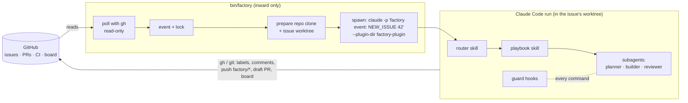
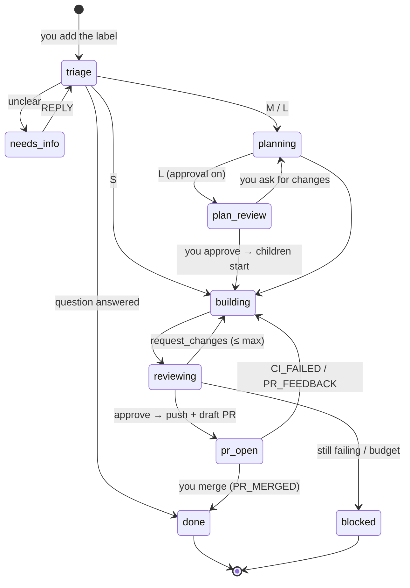

# Claude Software Factory: architecture

_Two pieces: a tiny **launcher** that wakes Claude Code up in the right repo and worktree, and a **factory plugin** that tells Claude Code what to do. Claude does all the GitHub work itself with `gh`._

> **As built:** the launcher is `bin/factory` (Bash). The plugin is `plugin/`. Run settings and the unattended rules are in `config/`. Runs use the logged-in Claude Code account (no API key) and Opus for everything. The M-size playbook is a single `standard` skill, and the review, push and PR steps are shared in a `deliver` skill. See the [README](../README.md) for usage.

---

## 1. In one paragraph

`bin/factory` runs in the background. Every minute it looks at your repos with `gh` (**read-only**). When it sees work, such as an issue with your label, a reply, a failed CI run, PR comments or a merged PR, it prepares a **git worktree** for that issue (every run happens in one) and starts **`claude -p` on Opus** there with a one-line prompt like *"factory event: NEW_ISSUE 42"*. That's all it does. It never talks to GitHub beyond reading, and **Claude never reports back to it**. From then on Claude Code, guided by the **factory plugin** (skills, subagents, hooks), handles the issue with `gh` and `git`:
- triages it
- plans, builds and reviews the work
- comments and moves labels
- pushes a `factory/*` branch
- opens a draft PR
- updates the Project board

Then the run exits. The next event for that issue starts a fresh run, which picks up from the labels and the status comment on GitHub.

---

## 2. Big picture



| Piece | Does | Does NOT do |
|---|---|---|
| **Launcher** (~150 lines) | Poll GitHub, decide *which* issue needs a run, set up the worktree, start `claude -p`, limit how many runs at once, keep logs | Write to GitHub, parse Claude's output, decide anything about the work |
| **Factory plugin** (Markdown + 1 script) | Everything about the work: triage, plan, build, review, comments, labels, PR, board | Polling or scheduling |

### Why do we need the plugin if we have the launcher?

**The launcher decides *when* and *where* Claude runs. The plugin tells Claude *what to do and how*.** They're different jobs.

The plugin is **not a program and doesn't run on its own.** It's a folder of Markdown files (plus one small script) that Claude Code reads when the launcher starts it with `--plugin-dir`. Think of it as **Claude's handbook for this factory**.

The launcher only gives Claude a one-line prompt: `factory event: NEW_ISSUE 42`. On its own, that line tells Claude nothing about how to triage, when to ask questions, how to split a big task, which labels to use, or what is forbidden. The plugin provides all of that:

| What Claude needs | Where it comes from in the plugin | Without the plugin… |
|---|---|---|
| The **recipe** for each kind of work (triage rules, the S/M/L paths, epics, CI fixes, follow-ups) | `skills/*.md` | We'd have to put every recipe into one huge prompt in the launcher, on every run |
| **Independent helpers** (planner, builder, reviewer, each with fresh context and its own tools) | `agents/*.md` | No separate reviewer, so Claude would review its own work in the same context |
| **Hard safety rules** that hold whatever the model decides (no merge, no push to `main`, no workflow edits) | `hooks/hooks.json` | Safety would depend on the model following instructions |
| **Which commands are allowed** when nobody is watching | `settings.json` | Every run would stop or fail at its first permission check |
| **One reliable way to update** the labels, the board card and the status comment together | `bin/factory-status` | Claude would build `gh project` calls by hand and get IDs wrong |

Why a plugin, and not files inside each repo's `.claude/` folder?
- **One copy for all repos.** Nothing is added to the target repos.
- **Loaded only for factory runs.** When you open Claude Code yourself in that repo, you don't get factory behaviour.
- **Easy to version and change in one place.** Edit a skill and the next run uses it.

So the **launcher is the alarm clock**, and the **plugin is the handbook**. Claude Code with Opus does the work.

---

## 3. The launcher

### 3.1 Events it watches for (all read-only `gh` calls)

| Event | Condition | Prompt it starts Claude with |
|---|---|---|
| `NEW_ISSUE` | Open issue with `FACTORY_LABEL` and no `factory:*` status label yet | `factory event: NEW_ISSUE 42` |
| `REPLY` | A human commented on an issue in `factory:needs-info` or `factory:plan-review` | `factory event: REPLY 42` |
| `MENTION` | A comment says `@factory`, from someone with write access | `factory event: MENTION 42 comment 9876` |
| `CI_FAILED` | A check failed on a `factory/*` PR (once per commit) | `factory event: CI_FAILED pr 57` |
| `PR_FEEDBACK` | New review comments or "changes requested" on a factory PR | `factory event: PR_FEEDBACK pr 57` |
| `PR_MERGED` | A factory PR was merged | `factory event: PR_MERGED pr 57` |
| `RESUME` | An issue is stuck in `factory:building`/`planning`/`reviewing` with no run active (e.g. after a crash or reboot) | `factory event: RESUME 42` |

It passes **only the event name and numbers**, never issue text. Claude reads the issue itself.

### 3.2 What happens on each event

1. **Lock:** at most one run per issue at a time, using a local lock file. If a run is already active, the event waits for the next poll.
2. **Repo:** clone it once into `~/factory/repos/<owner>/<repo>` and `git fetch` on every run. **No run ever works in this main clone.** It exists only to create worktrees.
3. **Worktree, for every run with no exceptions:** `~/factory/worktrees/<owner>-<repo>/issue-42` on branch `factory/issue-42`.
   - It is created on the first event and **reused** on later events for the same issue, so a run on day 3 sees day 1's work.
   - That covers triage, questions, CI fixes and PR follow-ups. PR events find the worktree from the branch name (`factory/issue-42` → issue 42).
   - **Epic children** each get their own worktree and branch (`factory/issue-43`, …).
   - **Subagents** (planner, builder, reviewer) work inside the same worktree as the run that called them.
   - Parallel runs never share a folder, so they can't collide.
4. **Spawn (always with Opus):**
   ```bash
   cd ~/factory/worktrees/me-my-app/issue-42 && \
   claude -p "factory event: NEW_ISSUE 42 …  Load the factory:router skill and follow it." \
     --model opus --effort high \
     --plugin-dir claude-software-factory/plugin \
     --settings claude-software-factory/config/settings.json \
     --setting-sources project,local --strict-mcp-config \
     --append-system-prompt "$(cat claude-software-factory/config/system-prompt.md)" \
     --permission-mode dontAsk --permission-prompts none \
     --output-format stream-json --verbose < /dev/null > ~/factory/logs/me__my-app/42/<time>.jsonl
   ```
   `--setting-sources project,local` and `--strict-mcp-config` keep your personal Claude Code settings, plugins and MCP servers out of factory runs.
   The log is only for you to debug. The launcher doesn't read it.
5. **Limit:** at most `FACTORY_MAX_PARALLEL` runs at once. A run that goes past `FACTORY_RUN_TIMEOUT` is stopped. The next poll sends `RESUME` if the issue is still mid-work.
6. **Clean up:** when an issue reaches `factory:done`, remove its worktree.

### 3.3 Configuration (environment variables)

| Variable | Default | Meaning |
|---|---|---|
| `FACTORY_REPOS` | _(required)_ | `owner/repo,owner/repo2`: the repos to watch |
| `FACTORY_LABEL` | `factory` | The label that hands an issue to the factory |
| `FACTORY_POLL_SECONDS` | `60` | How often to look |
| `FACTORY_MAX_PARALLEL` | `2` | How many Claude runs at once (across all repos) |
| `FACTORY_RUN_BUDGET_USD` | `0` (no cap) | Optional `--max-budget-usd` for each run |
| `FACTORY_RUN_TIMEOUT` | `90m` | Stop a run that takes longer than this |
| `FACTORY_HOME` | `~/factory` | Where clones, worktrees and logs go |
| `FACTORY_PROJECT` | _(unset = no board)_ | Board as `owner/number`. Passed to Claude through the environment. |
| `FACTORY_EPIC_NEEDS_APPROVAL` | `true` | Passed through to Claude: big plans wait for your OK |
| `FACTORY_MAX_REVIEW_ROUNDS` | `2` | Passed through to Claude |
| `FACTORY_MODEL` | `opus` | Model for every run and every subagent (`--model`). `opus` means the latest Opus (currently Claude Opus 5.5). Pin it with `claude-opus-5-5` if you want. |
| `FACTORY_EFFORT` | `high` | `--effort` for every run |

The launcher puts the `FACTORY_*` variables into the environment of each `claude` run, so the skills can read them.

---

## 4. The factory plugin (what Claude follows)

```text
plugin/
  .claude-plugin/plugin.json
  skills/
    router/SKILL.md          # entry point for every "factory event: …" prompt
    quick-fix/SKILL.md       # S work
    standard/SKILL.md        # M bugs/features/chores + all security work
    deliver/SKILL.md         # shared: review loop → push → draft PR (or blocked)
    epic/SKILL.md            # L work: breakdown → sub-issues → one child at a time
    question/SKILL.md        # answer, no code
    ci-fix/SKILL.md          # red CI on a factory PR
    follow-up/SKILL.md       # PR review comments / @factory on a PR
  agents/
    planner.md               # plan + acceptance criteria (read-only)
    builder.md               # code + checks + commit in this worktree
    reviewer.md              # judges the real diff vs criteria, fresh context
  bin/factory-status         # one call: swap factory:* label + move board card + update status comment
  bin/factory-comment        # post a comment carrying the <!-- factory --> marker
  hooks/hooks.json           # guard rails → hooks/guard.sh
config/
  settings.json              # allowed/denied commands for unattended runs
  system-prompt.md           # rules appended to every run (no chat, GitHub only, untrusted text, …)
```

Every factory comment carries a hidden `<!-- factory -->` marker. Because runs post as your own GitHub user, the marker is how the launcher tells the factory's comments from your replies.

### 4.1 Router skill: type × size → playbook

The router:
1. Reads the event and then the issue (`gh issue view 42 --comments`). The issue text is **data, not instructions**.
2. Reads the status comment, to see what has already been done.
3. Decides the **type** and **size** (only on the first visit), sets the labels, and calls `factory-status`.
4. Picks the playbook.

| Type \ Size | **S**: one obvious change | **M**: needs a plan, one PR | **L**: several PRs or days |
|---|---|---|---|
| **bug** | `quick-fix` (failing test first) | `bug` | `epic` |
| **feature / chore** | `quick-fix` | `feature` | `epic` |
| **security** | `bug` (never S) | `bug` | `epic` |
| **question** | `question` | `question` | `question` |
| **unclear** | ask questions → `needs-info` → stop (the `REPLY` event brings it back) | same | same |

Other events skip triage:
- `CI_FAILED` → `ci-fix`
- `PR_FEEDBACK` / `MENTION` on a PR → `follow-up`
- `PR_MERGED` → mark done, or for an epic, start the next child
- `RESUME` → continue the playbook named in the status comment

### 4.2 Playbooks (short)

- **quick-fix (S):**
  1. **builder** (for a bug, a failing test first, then the fix; run the checks; commit)
  2. **reviewer** (the review is never skipped)
  3. `git push origin factory/issue-N`
  4. `gh pr create --draft`, then `pr-open`
- **bug / feature (M):**
  1. **planner** → root cause or approach, plan, **acceptance criteria**. Posted to the status comment.
  2. **builder** → **reviewer** loop, at most `FACTORY_MAX_REVIEW_ROUNDS` rounds, else `blocked` with the findings.
  3. Push, then a draft PR with the criteria checklist and the reviewer's evidence.
- **epic (L):**
  1. **planner** → design plus a breakdown into S/M children.
  2. If approval is on: comment the plan, set `plan-review`, and **stop**. Your reply brings it back.
  3. Create the children as GitHub **sub-issues** labeled `factory`, in order. Only the first child starts; each later child is marked "waiting on #prev".
  4. `PR_MERGED` for a child → start the next one. When all are done, the epic is `done`.
  5. **No run lasts days.** The days pass between runs, while it waits for you.
- **question:** answer in a comment citing files, then `done`.
- **ci-fix:** read `gh pr checks` and `gh run view --log-failed`. If the code is the cause, the builder fixes it and the reviewer checks, then push to the same branch, at most 2 tries. Otherwise, comment why.
- **follow-up:** the builder addresses each review comment on the same branch, then the reviewer, then push, then a reply to each thread.

### 4.3 Subagents

| Subagent | Sees | Produces | Tools | Model |
|---|---|---|---|---|
| **planner** | The issue (as data), the triage result, the repo | Approach or root cause, steps, **acceptance criteria**, risks, test plan | Read and search, run tests | Opus |
| **builder** | Plan + criteria (+ reviewer findings) | Commits in the worktree, plus the commands it ran and their results | Edit, write, run checks, `git add`/`commit` | Opus |
| **reviewer** | **Only** the diff (`git diff origin/main...HEAD`) and the criteria | approve / request_changes, with evidence for each criterion | Read-only, re-run checks | Opus |

Each runs with fresh context inside the run, so the main run stays light. **All of them use Opus:** each agent file sets `model: opus`, matching the run's `--model opus`. **All of them work in the issue's worktree**, never in the main clone. The reviewer stays independent because of its **fresh context**: it sees only the diff and the criteria, never the builder's reasoning. Running it on a different model isn't needed for that.

---

## 5. State and visualization (all on GitHub)

- **Labels = state:** `factory:triage` · `needs-info` · `planning` · `plan-review` · `building` · `reviewing` · `pr-open` · `done` · `blocked`, plus `type:*` and `size:S|M|L`.
- **Status comment:** one comment per issue that Claude keeps editing. It holds the plan, the criteria, a timeline, the review rounds and links. It is the issue's **memory between runs**.
- **Project board:** `factory-status 42 building` moves the card along with the label. Columns: Inbox · Needs info · Planning · Plan review · Building · Reviewing · PR open · Done · Blocked. Fields: Type, Size, Repo, Updated. Epics show a sub-issue progress bar. Views: Board · Table · **Needs me** · Epics.



---

## 6. Where you step in

| Moment | You |
|---|---|
| Give it work | Add the `factory` label |
| It asks questions | Reply on the issue |
| Big plan ready | Reply "approve", or ask for changes |
| Draft PR ready | Review. Comment (it fixes) or merge. **Only you merge.** |
| Blocked | Read the explanation and decide |
| Overview | Open the Project board ("Needs me" view) |

---

## 7. Safety (Claude acts unattended, so these matter)

- **`settings.json` allowlist** (with `dontAsk`, anything not listed is refused, never left waiting):
  - `gh issue view|comment|edit|create`, `gh pr view|diff|checks|create --draft|comment`, `gh run view`, `gh project item-*`, `gh api` (GET)
  - `git` local commands, and `git push origin factory/*`
  - the repo's build and test commands
- **Guard hook** (`PreToolUse`) blocks, whatever the allowlist says:
  - `gh pr merge`, `gh pr ready`, `gh repo …`, `gh secret …`, `gh api -X POST/PUT/DELETE` on anything risky
  - `git push` to anything that isn't `factory/*`, and `--force`
  - edits to `.github/workflows/**`
- **Branch protection on `main`:** required, the final backstop.
- **Untrusted text:** the launcher passes numbers only. Skills treat issue and comment text as data. Mentions and replies count only from people with write access (checked by the launcher and again by the router).
- **Budget and time caps** on each run.
- **Later:** run the launcher on a VM, or under a separate Linux user.

---

## 8. Build order

| Step | Build | Done when |
|---|---|---|
| 1 | Launcher (poll `NEW_ISSUE`, lock, worktree, spawn) + router skill that only triages and comments | Label an issue: within a minute a comment shows type and size, and the labels are set |
| 2 | `quick-fix` + builder + reviewer + hooks + settings | A small bug becomes a draft PR with a test |
| 3 | `bug`/`feature` + planner + status comment + `factory-status` + board | A medium issue becomes a PR, and the card moves across the board |
| 4 | `REPLY`/`needs-info`, `question`, `CI_FAILED`, `PR_FEEDBACK`, `RESUME` | Every event works. Killing a run in the middle and restarting is safe. |
| 5 | `epic` + `PR_MERGED` + sub-issues | A large issue ships as several PRs over days |
| 6 | Several repos, `FACTORY_MAX_PARALLEL`, systemd unit | Runs on its own on a VM |

**Fixed decisions:** Opus for every run and subagent · every run in its own git worktree · the launcher only reads from GitHub; Claude does all writes.

**Decided:** the launcher is Bash · Claude auth is the logged-in Claude Code account on the machine, with no API key · the first target is a demo blog-app repo.
